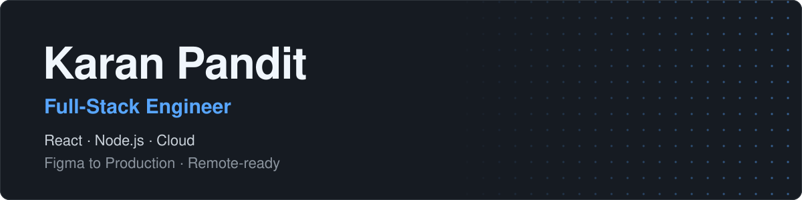

  

  

## About

I'm a full-stack engineer working across React, Node.js and the cloud. I take products from Figma designs through to production, and I'm ready to work remotely.

## Tech stack

<table>
  <tr>
    <td><strong>Frontend</strong></td>
    <td>
      &nbsp;
      &nbsp;
      &nbsp;
      &nbsp;
      &nbsp;
      
    </td>
  </tr>
  <tr>
    <td><strong>Backend and tooling</strong></td>
    <td>
      &nbsp;
      
    </td>
  </tr>
  <tr>
    <td><strong>Design</strong></td>
    <td>
      
    </td>
  </tr>
</table>

## GitHub activity

View stats and languages

 

  
  

